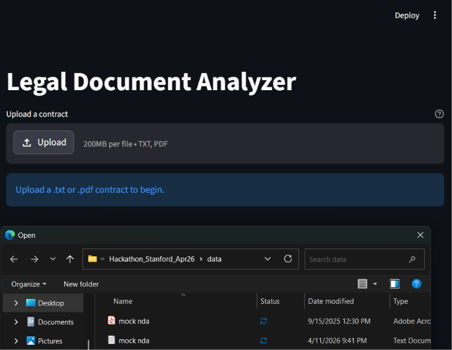
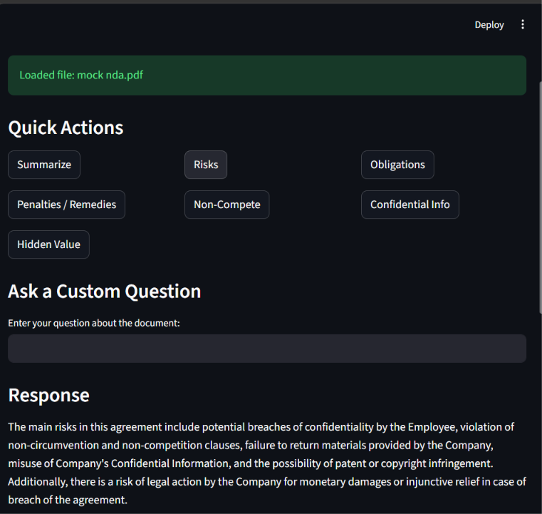
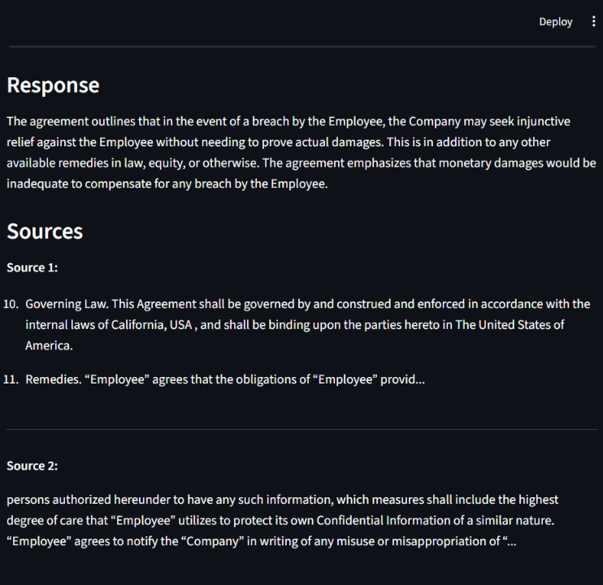

# Legal Document Analyzer

An AI-powered legal document analysis application built with **Python, Streamlit, LlamaIndex, and OpenAI**. Developed during a Stanford hackathon, the application uses **Retrieval-Augmented Generation (RAG)** to analyze legal agreements, retrieve relevant contract passages, and answer natural-language questions.

## Overview

The Legal Document Analyzer allows users to upload PDF or TXT contracts and interact with their contents through a web-based interface.

Instead of manually searching through lengthy agreements, users can request summaries, identify contractual obligations, examine potential risks, and ask custom questions. The application retrieves relevant document passages and uses a large language model to generate context-aware responses.

## Technologies Used

- **Python** — Core application logic and document processing
- **Streamlit** — Interactive web interface and file upload functionality
- **LlamaIndex** — Document ingestion, vector indexing, semantic retrieval, and query orchestration
- **OpenAI API** — Text embeddings and language-model responses
- **PyPDF** — PDF document parsing through LlamaIndex

## Features

- Upload and analyze PDF or TXT legal agreements
- Generate contract summaries
- Identify potential legal and financial risks
- Extract contractual obligations and remedies
- Examine non-compete and confidentiality provisions
- Analyze clauses that may create economic value or risk
- Ask custom natural-language questions
- Display retrieved source excerpts supporting generated responses

## How It Works

The application implements a Retrieval-Augmented Generation (RAG) pipeline:

1. **Document Upload:** Users upload a PDF or TXT agreement through the Streamlit interface.
2. **Document Processing:** LlamaIndex reads and parses the uploaded document.
3. **Vector Indexing:** Document content is converted into embeddings and organized into a vector index.
4. **Semantic Retrieval:** Relevant document passages are retrieved based on the user's question.
5. **Response Generation:** An OpenAI language model uses the retrieved context to generate an answer.
6. **Source Display:** Retrieved document excerpts are displayed alongside the response for reference.

## Installation

### Prerequisites

- Python 3.10 or later, using a version supported by the installed dependencies
- An OpenAI API key
- Internet access for OpenAI API requests

### Setup

Clone the repository:

```bash
git clone https://github.com/rorysender/legal-document-analyzer.git
cd legal-document-analyzer
```

Create and activate a virtual environment:

```bash
python -m venv .venv
```

On Windows:

```bash
.venv\Scripts\activate
```

On macOS/Linux:

```bash
source .venv/bin/activate
```

Install dependencies:

```bash
pip install -r requirements.txt
```

Configure the `OPENAI_API_KEY` environment variable.

For example, in Windows PowerShell:

```powershell
$env:OPENAI_API_KEY="your-api-key"
```

On macOS/Linux:

```bash
export OPENAI_API_KEY="your-api-key"
```

Never commit your API key to GitHub.

Start the application:

```bash
streamlit run app.py
```

Open the local Streamlit interface in your browser, upload an agreement, and begin analyzing it.

## Screenshots

### Document Upload



### Contract Analysis



### Source Retrieval



## Project Background

This project was developed during a Stanford hackathon as an exploration of practical applications for large language models and semantic document retrieval.

The goal was to create an accessible interface for examining complex legal documents while gaining hands-on experience with Python application development, vector embeddings, retrieval-augmented generation, and API integration.

## Limitations

- Generated responses may contain inaccuracies or omit important contractual details.
- Retrieved source excerpts should be checked against the original agreement.
- The application requires an OpenAI API key and may incur API usage costs.
- Uploaded document content is processed using third-party AI services.
- The application is intended for educational and informational purposes, not professional legal advice.
